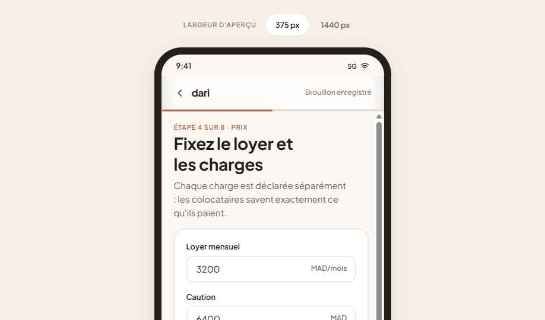
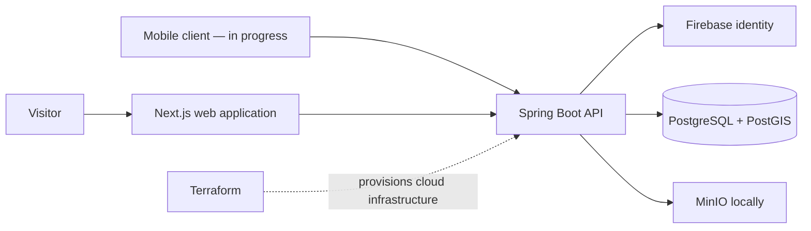

# Dari — a Moroccan colocation marketplace

Dari is a full-stack product for discovering shared accommodation in Morocco.
It combines a Spring Boot API, a Next.js web experience, spatial search with
PostGIS, and a separate Expo mobile client.

> **Current status:** the API and web marketplace are implemented. The mobile
> client is in progress; device validation and store-release work remain.

<p align="center">
  
</p>

*A checked-in product prototype; it is not presented as a production screenshot.*

## Why it matters

- **Product workflow:** public discovery, accounts, listing publication,
  messaging, and moderation are represented in the product architecture.
- **Location-aware backend:** PostgreSQL 16 and PostGIS support the marketplace
  domain, while Flyway owns schema evolution.
- **Deliberate boundaries:** Firebase provides identity; the API owns product
  authorization and data access. Exact listing coordinates are treated as
  private application data.
- **Multiple clients, one domain:** Next.js is the primary web product and the
  Expo/React Native client is developed separately against the same platform.

## Architecture



The [architecture document](ARCHITECTURE.md) distinguishes implemented paths,
scaffolding, and the constraints the current design is not intended to solve.

## Technology choices

| Area | Technologies |
| --- | --- |
| API | Java 21, Spring Boot 3, Flyway |
| Data and search | PostgreSQL 16, PostGIS |
| Web | Next.js App Router |
| Mobile | Expo, React Native — in progress |
| Local services and infrastructure | Docker Compose, MinIO, Terraform |

## Repository layout

```text
apps/
  api/            Spring Boot API and Flyway migrations
  web/            Next.js application
  mobile/         Standalone Expo application
design-system/    Tokens, component references, and prototypes
docs/             Active documentation and historical archive
infra/            Local services, operational scripts, and Terraform
```

## Local development

Prerequisites: Git, Docker Desktop with its Linux engine, JDK 21, Node.js, and
npm. The API also needs a Firebase service-account file; see
[the Firebase setup note](infra/firebase/README.md).

```powershell
Copy-Item .env.example .env
Copy-Item apps/web/.env.local.example apps/web/.env.local
./infra/scripts/dev.ps1 up
./infra/scripts/dev.ps1 api
./infra/scripts/dev.ps1 web
```

The Compose stack starts PostGIS and MinIO only. Run the API and web commands in
separate terminals; they run on the host for hot reload.

## Validation

```powershell
# API compilation and repository-focused checks
cd apps/api
./mvnw -B -ntp -DskipTests compile

# Full API suite; Docker is required for Testcontainers
./mvnw test

# Web checks
cd ../web
npm run typecheck
npm run lint
npm run tokens:check
npm run build

# Mobile checks
cd ../mobile
npm run typecheck
npm test
```

From the repository root, `./infra/scripts/dev.ps1 check` runs API
test-compilation, web typechecking, and token-drift verification. The commands
above are documented from the checked-in scripts; validation results for this
cleanup are reported with its change set.

## Documentation

- [Documentation index](docs/README.md)
- [Architecture](ARCHITECTURE.md)
- [Production operations](docs/operations/production-operations.md)
- [Product design](docs/product/colocation-platform-design.md)
- [Mobile release guide](docs/mobile/mobile-release.md)

## Scope and next steps

The checked-in API and web marketplace are the most complete surfaces. The
standalone mobile client still needs device validation and store-release work.
See [TODO.md](TODO.md) for the current checklist; do not infer a public
deployment or a completed mobile release from this repository.
